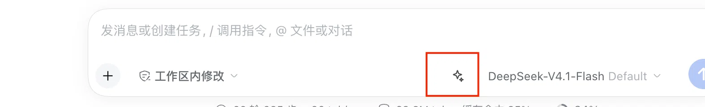

# dsh-prompt-enhance

**A ✨ button in the DeepSeek Harness composer that rewrites your rough draft into a clear, well-structured prompt — then puts it straight back into the input box.**

Type a half-formed thought, click once, send a well-specified request. No copy-paste, no second window, no leaving the conversation.

> Same idea as the "enhance prompt" button in WorkBuddy and similar chat clients, built as a native DSH plugin.

---

## Contents

- [What it looks like](#what-it-looks-like)
- [Real example](#real-example)
- [Why not just retype it](#why-not-just-retype-it)
- [Requirements](#requirements)
- [Install](#install)
- [Configuration](#configuration)
- [Usage](#usage)
- [How it works](#how-it-works)
- [Design decisions](#design-decisions)
- [Troubleshooting](#troubleshooting)
- [Known limitations](#known-limitations)
- [Development notes](#development-notes)
- [Project layout](#project-layout)
- [Uninstall](#uninstall)
- [FAQ](#faq)
- [License](#license)

---

## What it looks like



A sparkle button appears in the composer toolbar — **boxed in red above**, between the permission selector and the model picker.

It registers into `conversation.input.right`, a **list** slot immediately left of the model selector. Being a list slot matters: it can coexist with other composer buttons, and it never competes with the voice-input button that owns the neighbouring single-valued `conversation.input.activity` slot.

### Button states

| State | Look | Meaning |
|---|---|---|
| Idle | Grey ✨ at 75% opacity, brightens on hover | Ready |
| Busy | Small spinning ring | Waiting on the model |
| Error | ✨ turns red; hover shows the reason | See [Troubleshooting](#troubleshooting) |
| Disabled | 45% opacity, no hover response | No session, or a submission is in flight |

---

## Real example

Input:

```
关于 iPhone 多评测的微博，折痕到底是有没有折痕
```

After clicking ✨:

```
请基于目前公开的 iPhone 折叠屏评测内容，说明屏幕折痕的实际程度：
折痕是否明显、在哪些角度或光线下可见、与同类产品相比表现如何。
请区分客观测试结论与主观手感描述，并说明信息来源。
```

Input:

```
带哦上官金虹感觉看电视呢
```

After clicking ✨:

```
请说明上官金虹与看电视这一说法之间的关联，我的表述可能有误，
请先澄清可能的原意，再给出对应解释。
```

The rewrite keeps your intent and language, fixes garbled text, makes the goal explicit, and adds structure **only when it helps**. It never invents requirements you did not imply, and it never answers the prompt — it only rewrites it.

---

## Why not just retype it

Retyping works. This exists for the cases where it doesn't:

- **You're thinking out loud.** Voice input, dictation, or a half-finished sentence produces a draft that is right in substance and wrong in form.
- **You're on the wrong keyboard.** Switching input methods mid-thought breaks flow.
- **You don't know what the agent needs.** A good prompt states the goal, the subject, the constraint, and what "done" looks like. Knowing that helps; writing it every time doesn't.
- **Rewrites are cheap and reversible.** The result lands in the draft, not in the send buffer. Edit it, undo it, or ignore it.

---

## Requirements

| Requirement | Notes |
|---|---|
| **DeepSeek Harness** | Desktop app or a web profile. Built against the bundled bundles; no source checkout needed. |
| **A working model route** | The plugin calls `ctx.llm.stream()` on an explicitly configured provider/model. Whatever you already chat with will do. |
| **`dsh-client-ui-conversation`** | Ships with DSH; declared as the client dependency. |
| **`dsh-commands`** | Ships with DSH; the plugin needs the `commands` service. |

Nothing else. No build step, no dependencies, no npm packages of its own — the plugin is three source files.

---

## Install

### Step 1 — get the package into your profile

```bash
git clone https://github.com/AntMan-xtalgh/dsh-prompt-enhance.git
cd dsh-prompt-enhance
```

Then install it into a profile. Replace `desktop` with your profile name if different (`ls ~/.dsh/profiles/`).

```bash
dsh plugin --profile desktop add "$(pwd)"
```

If that fails with a pnpm workspace-root error, use the DSH-bundled pnpm directly:

```bash
PNPM="/Applications/DeepSeek Harness.app/Contents/Resources/runtime/primary-runtime/dependencies/pnpm/bin/pnpm.cjs"
cd "$HOME/.dsh/profiles/desktop"
node "$PNPM" add -w "file:/absolute/path/to/dsh-prompt-enhance"
```

> **Use DSH's own pnpm.** A Homebrew or system pnpm with a different store major version fails with
> `ERR_PNPM_UNEXPECTED_STORE` because your profile's `node_modules` is linked from pnpm 11's store.

### Step 2 — register the bundle

Open `~/.dsh/profiles/desktop/package.json` and add the package to `dsh.profile.bundles`:

```json
{
  "dsh": {
    "profile": {
      "bundles": [
        "@deepseek-ai/dsh-base",
        "@deepseek-ai/dsh-web-app",
        "… your existing bundles …",
        "dsh-prompt-enhance"
      ]
    }
  }
}
```

`pnpm add` puts the package in `dependencies`; this step is what actually tells DSH to load it.

### Step 3 — point it at a model

Append to `~/.dsh/profiles/desktop/cordis.patch.yml`:

```yaml
- id: prompt-enhance
  name: "dsh-prompt-enhance"
  config:
    provider: moxing
    model: deepseek-flash-1017
```

Use the route you already run. If unsure, open the model picker in the composer and read the name — the left part is usually the provider, the right part the model.

> The `id` must match the one in this package's `cordis.patch.yml`. That is how a profile-level entry overrides the bundle's inserted row rather than adding a second one.

### Step 4 — restart DSH

**Cmd+Q** to quit fully (closing the window does not unload plugins), then relaunch.

The ✨ appears left of the model selector. If it does not, see [Troubleshooting](#troubleshooting).

### Verify it loaded

```bash
ls ~/.dsh/profiles/desktop/node_modules/dsh-prompt-enhance/
# client.js  cordis.patch.yml  index.js  locale  package.json
```

---

## Configuration

All configuration lives in the profile patch from step 3.

| Field | Type | Required | Meaning |
|---|---|---|---|
| `provider` | string | **yes** | Provider route id, e.g. `moxing`, `deepseek-official` |
| `model` | string | **yes** | Model id on that route, e.g. `deepseek-flash-1017` |

Both must be set together. `ctx.llm.listProviders()` reports provider ids but not their models, and the session's own resolved route is not exposed to plugin code — so this pair cannot be auto-detected. See [Known limitations](#known-limitations).

The rewrite instruction is a constant in `index.js` (`SYSTEM_PROMPT`). Fork and edit it if you want a different rewriting policy — for example, always produce English, or always emit a bullet list.

---

## Usage

1. Type anything into the composer — a fragment, a garbled sentence, a rough plan.
2. Click **✨**.
3. Wait a moment. The draft is **replaced in place** with the rewrite.
4. Edit it if you want, then send as usual.

Notes:

- **The draft is replaced, not appended.** Undo (Cmd+Z) restores the original.
- **Multi-line drafts are flattened** for the model call, because a command line may not contain line breaks. Line breaks are collapsed to single spaces, not dropped.
- **An empty draft does nothing** except show a short hint.
- **The button is per-session.** Each session has its own composer and its own button state.
- **Concurrent sends are safe** — if a submission is in flight, the button is disabled rather than racing it.

---

## How it works

```
Client (browser)                                Host (process)
─────────────────                               ──────────────

  ✨ click
      │
      ├─ read document.querySelector('[data-composer-input]').innerText
      │
      ├─ ctx.remote.commands.execute(
      │      sessionId,
      │      '/enhance <draft>',
      │      []
      │  )                                    →  ctx.commands.register({
      │                                             name: 'enhance',
      │                                             recordInput: false,
      │                                             handler: async ({ agent, rawInput, signal }) => {
      │                                               // resolve provider/model from config
      │                                               for await (chunk of ctx.llm.stream({ … })) {
      │                                                 if (chunk.type === 'text-delta') text += chunk.text
      │                                               }
      │                                               return { kind: 'success', text }
      │                                             }
      │                                           })
      │
      ├─ unwrap { ok, value: { commandId, result: { kind, text } } }
      │
      └─ inputActions.setDraft(rewrittenText)
```

The command uses `recordInput: false`, so the draft is **not** written into the session log as a user message. Nothing reaches the model's conversation history.

---

## Design decisions

These are the choices that shaped the plugin, and why.

### Registered into a list slot, not the activity slot

`conversation.input.activity` is exactly where WorkBuddy puts its sparkle — between the model selector and the send button. It is also, in DSH:

```js
"conversation.input.activity": { kind: "single", scope: "session" }
```

**Single-valued.** It is the slot the bundled voice-input plugin claims for its microphone, and a control there can expand to fill the whole toolbar while active. Putting the button there would make the two mutually exclusive and squat on a reserved interaction.

```js
"conversation.input.right": { kind: "list", scope: "session" }
```

**List-valued.** It sits immediately left of the model selector, takes multiple registrations, and conflicts with nothing. The button lands one control to the left of where WorkBuddy puts it — a fair trade for never breaking voice input.

### A command as the transport, not a custom Remote

A browser plugin cannot call `ctx.llm` directly; that service lives in the Host process. Two transports exist:

| Transport | Leaves a UI trace | Effort |
|---|---|---|
| Session command (`ctx.remote.commands.execute`) | Yes — one flow node | Small |
| Custom typert Remote (how voice input works) | No | Large |

The command route was chosen to get a working plugin first. The cost is documented in [Known limitations](#known-limitations) and is the one known deviation from WorkBuddy's behaviour.

### Reading the draft from the DOM

The provide channel gives plugins `inputActions` — the write side (`setDraft`, `insertText`, `submit`) — but not the draft text. `[data-composer-input]` on the editor's contenteditable root is the only available source. It is official DSH markup (`role="textbox"`, `aria-multiline="true"`), not an incidental class name, but it is still a coupling point.

### Explicit model route

`ctx.llm.listProviders()` returns `{ id, name }` only — no models. The session's resolved route lives behind `request/header` internals that are not reachable from plugin code. Rather than guess at unstable paths, the route is explicit config: predictable, debuggable, and one line to change.

---

## Troubleshooting

Every failure path has its own message. Hover the red button to read it.

### `cannot get property "remote.commands" without inject`

Your `client.js` declares `inject` without the qualified sub-service path. Cordis gates service access on declared paths, and **parent and child are separate entries**:

```js
inject: ['slots', 'remote', 'remote.commands', 'locale']  // ✅
inject: ['slots', 'remote', 'locale']                     // ❌
```

Confirm with `grep -n "inject: \['slots'" client.js`.

### `No /enhance command: the Host half is not mounted.`

The command did not resolve, so the Host half is not running. Check, in order:

1. `dsh-prompt-enhance` is in `dsh.profile.bundles` in the profile's `package.json` — installing the package is not enough.
2. `~/.dsh/profiles/desktop/node_modules/dsh-prompt-enhance/` exists.
3. You quit with **Cmd+Q** and relaunched. Closing the window is not a restart.
4. The Host half imports cleanly:

   ```bash
   cd ~/.dsh/profiles/desktop/node_modules/dsh-prompt-enhance
   node --input-type=module -e "import('./index.js').then(m => console.log(Object.keys(m)))"
   # → [ 'apply', 'inject', 'name' ]
   ```

### `The model returned an empty prompt.`

The stream produced no `text-delta`. Usually one of:

- **Reasoning model ate the budget.** `maxTokens` is 4096 in `index.js`; raise it for a chatty reasoning model.
- **A chunk-field mismatch after a DSH update.** If DSH renamed `chunk.type`, the loop silently collects nothing. See [Development notes](#development-notes).
- **The route rejected the request but reported a normal finish.** Try a different model in the config.

### `Prompt enhancement failed: …`

The message after the colon is the underlying error. Common ones:

| Suffix | Cause |
|---|---|
| `NO_ADAPTER` | `provider` in your config does not match any registered route |
| `MISSING_CREDENTIAL` / `AUTH` | The route's API key is missing or rejected |
| `RATE_LIMIT` | Backing off and retrying is worth it |
| `CONTEXT_WINDOW_EXCEEDED` | The draft is larger than the model's window |

### `No model route: set provider and model …`

Step 3 is missing or the `id` does not match. The patch entry must read `id: prompt-enhance`.

### `The enhance command was refused.`

Admission rejected the line. Usually a mangled `sessionId` — reload the page.

### The button is missing entirely

- Bundle not in `dsh.profile.bundles`, or DSH was not fully restarted.
- A client-side crash. Check the DevTools console (Cmd+Option+I in the desktop app) for errors containing `dsh-prompt-enhance`.

### `ERR_PNPM_UNEXPECTED_STORE`

You installed with the wrong pnpm. Use DSH's bundled one — see step 1.

### Edits to the source do nothing

`file:` dependencies are **copies**, not symlinks. Re-copy after editing:

```bash
cp index.js client.js "$HOME/.dsh/profiles/desktop/node_modules/dsh-prompt-enhance/"
# then Cmd+Q and relaunch
```

---

## Known limitations

### The command leaves one line in the transcript

DSH renders every admitted command as a persistent flow node. `dsh-client-ui-commands` hardcodes the fallback:

```js
text ?? (node.outcome.kind === "error" ? t("command.failed") : t("command.done"))
```

So returning empty text still shows a generic "command done" row. Removing it requires a real typert Remote instead of the command channel — a deliberate larger change, not a bug.

### The model route is explicit, not inherited

The plugin does not read the session's own `request/header` route. Configured once per profile; change it when you switch models.

### Draft reading depends on a DOM attribute

`[data-composer-input]` is the only source. If DSH renames it, the button reads an empty draft and reports "type something first".

### Multi-line drafts are flattened

Command lines cannot contain line breaks, so paragraphs are joined with spaces before the model call. The model usually restores structure; occasionally it does not.

### Rewrites are not diffable

The draft is replaced outright. Undo restores it, but there is no side-by-side compare. A preview mode would need a confirm step, which trades away the one-click appeal.

---

## Development notes

Everything below cost real debugging time. It is written down so it costs you none.

### `inject` must name the full service path

Cordis gates access on declared paths. Reaching `ctx.remote.commands` needs the qualified path **beside** its parent namespace — declaring only the parent throws at call time, not at load:

```js
inject: ['slots', 'remote', 'remote.commands', 'locale']  // ✅
inject: ['slots', 'remote', 'locale']                     // ❌
```

Reference: `@deepseek-ai/dsh-client-ui-plan` declares the same pair.

### Stream chunks are discriminated by `type`

```js
chunk.type === 'text-delta'   // ✅
chunk.kind === 'text-delta'   // ❌ silently yields empty text forever
```

`BlockAssembler` switches on `chunk.type` — same field. Reasoning routes emit `reasoning-delta` chunks first; **only `text-delta` is the answer**. Accumulating reasoning into the result produces a polluting preamble.

### The terminal chunk carries `reason`

```js
{ type: 'finish', reason: { kind: 'stop' | 'error' | 'aborted' | 'max-tokens', failure? } }
```

Not `chunk.finish`. Read `reason.kind` before reading `reason.failure`.

### Command results nest three deep

```
{ ok: true, value: { commandId, result: { kind: 'success' | 'error', text, data? } } }
```

The wrapper layers differ between the Remote edge and the executor. Unwrap by **locating `kind`**, not by a fixed path:

```js
let node = execution
for (let depth = 0; depth < 4; depth += 1) {
  if (typeof node?.kind === 'string') break
  node = node?.value ?? node?.result
  if (node == null) break
}
```

### `data` is dropped in transit

`dsh-commands`' `settle()` forwards only `kind`, `text`, and `sourceEventSeq`:

```js
return Object.freeze({ commandId, result: Object.freeze(result) })
```

The rewrite **must** travel in `text`. Putting it in `data` looks correct and arrives empty.

### `maxTokens`, not `maxOutputTokens`

`GenerateOptions` sampling is limited to `temperature`, `maxTokens`, and `stop`. Unknown keys are ignored without complaint. Reasoning routes spend output budget on thinking first — 2048 can leave visible text empty; this uses 4096. An `error` settlement requires non-empty `text`; a `success` may omit it.

### There is no top-level `system` option

Pass the instruction as a message:

```js
messages: [
  { role: 'system', content: [{ type: 'text', text: SYSTEM_PROMPT }] },
  { role: 'user',   content: [{ type: 'text', text: draft }] },
]
```

### Slot kinds are not interchangeable

| Slot | Kind | Use |
|---|---|---|
| `conversation.input.right` | `list` | Extra toolbar buttons (this plugin) |
| `conversation.input.left` | `list` | Left-side toolbar buttons |
| `conversation.composer.dock` | `list` | Below the composer card |
| `conversation.input.activity` | `single` | Reserved: voice input |
| `conversation.input.model` | `single` | Reserved: model selector |

### Client plugin constraints

The browser half runs in a sandbox: **plain JavaScript, no JSX, no TypeScript, no module imports.** Its globals are `React`, `console`, `styles`, and (for dynamic plugins) `host`. Register factories via `window.__ModuleLoader__.load({ id, factory })` with the id equal to the package name.

---

## Project layout

```
dsh-prompt-enhance/
├── package.json          # manifest: exports, dsh.bundle, dsh.client
├── cordis.patch.yml      # inserts the plugin row into the profile
├── index.js              # Host half — registers /enhance, streams the rewrite
├── client.js             # Client half — the ✨ button and the RPC call
├── locale/
│   ├── en.json           # English strings
│   └── zh.json           # 中文字符串
├── docs/
│   └── composer.png      # the screenshot above
├── README.md
└── LICENSE
```

Both halves are small: `index.js` is the command registration plus one stream loop; `client.js` is the button component plus one RPC call and its result unwrapper.

---

## Uninstall

```bash
cd ~/.dsh/profiles/desktop
```

Then:

1. Remove `"dsh-prompt-enhance"` from `dsh.profile.bundles` in `package.json`.
2. Remove the `- id: prompt-enhance` block from `cordis.patch.yml`.
3. Delete the package:
   ```bash
   rm -rf node_modules/dsh-prompt-enhance
   ```
4. Cmd+Q and relaunch.

The plugin writes nothing outside the profile: no state, no cache, no telemetry, no network calls except the model request you configured.

---

## FAQ

**Does this send my draft anywhere besides my configured model?**
No. One request to the route in your config, through `ctx.llm.stream()`. No telemetry, no analytics, no third-party endpoints.

**Does the rewrite count against my context window?**
No. `recordInput: false` keeps it out of the session log, so neither the draft nor the rewrite enters the conversation history. Only the model call itself is billed.

**Can I have more than one button here?**
Yes — `conversation.input.right` is a list slot. Copy this package, change `name` / `id` / the command name, and both will render side by side.

**Can I change what the rewrite does?**
Edit `SYSTEM_PROMPT` in `index.js`. It is a plain constant. Re-copy into the profile and restart.

**Does it work in the web profile?**
It should — the client half declares `platform: "web"` and uses no desktop-only APIs. It has been exercised on the desktop app only.

**Why does English README describe a Chinese-first feature?**
The rewrite follows the language of your draft, whatever that is. `locale/` carries both English and Chinese UI strings.

---

## Contributing

Issues and pull requests welcome. Two asks:

- **Report the exact hover message.** Every failure path has its own string; it identifies the layer that broke.
- **Say which DSH version you are on.** Chunk field names and slot kinds are internal APIs and may move.

The highest-value contribution right now is the **typert Remote** replacement for the command transport, which would remove the transcript line. See [Known limitations](#known-limitations).

---

## License

[MIT](LICENSE)
